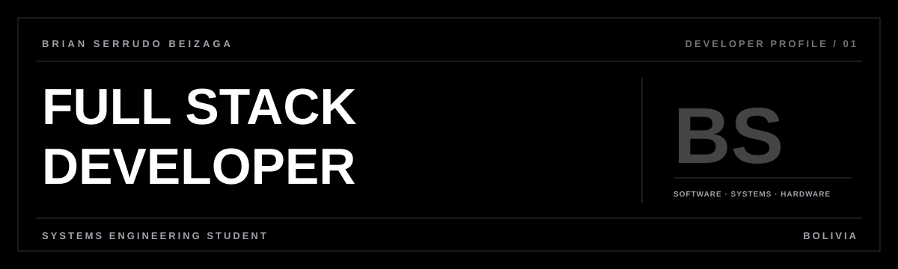

  

<a href="https://brian-portfolio-psi.vercel.app/">PORTFOLIO</a>

---

### ABOUT ME

I'm **Brian Serrudo Beizaga**, a Full Stack Developer and **Systems Engineering** student in Bolivia. I'm 20 years old, with experience in software architecture, backend development, network administration, and integrating software with custom hardware.

I'm interested in building scalable solutions, improving processes, and taking digital ideas from prototype to working product.

### SOCIALS

### TECHNOLOGIES & TOOLS

**Backend & languages** 

**Design & interfaces** 

**Databases & deployment** 

### FEATURED PROJECTS

| Project | Description |
| :--- | :--- |
| [Veterinary Atlas](https://github.com/Utmostbrian/Atlas_Veterinario_UDI) | Academic platform with a veterinary drug catalog and AI-assisted information. |
| [Utmost-FM](https://github.com/Utmostbrian/Utmost-FM) | Desktop music player with a retro look and audio visualizations. |

---

### LET'S WORK TOGETHER

